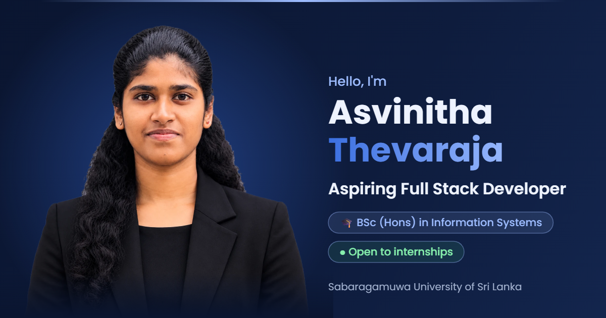

# Asvinitha Thevaraja | Personal Portfolio

  

Welcome to my personal portfolio! This website showcases my background, skills, projects, and interests as an Information Systems undergraduate passionate about Software Engineering and technology.

## About Me

I am an Information Systems undergraduate at Sabaragamuwa University of Sri Lanka with a strong passion for Software Engineering and technology. I enjoy exploring innovative ideas, solving real-world problems, and creating meaningful digital experiences. I am always eager to learn, embrace new challenges, and continuously improve my skills while turning creative ideas into practical solutions.

## Portfolio Highlights

- Personal Introduction
- About Me
- Skills and Expertise
- Featured Projects
- Education
- Contact Information

## Connect With Me

- GitHub: https://github.com/Asvinitha-Thevaraja
- LinkedIn: https://www.linkedin.com/in/asvinitha-thevaraja/

---

Thank you for visiting my portfolio!